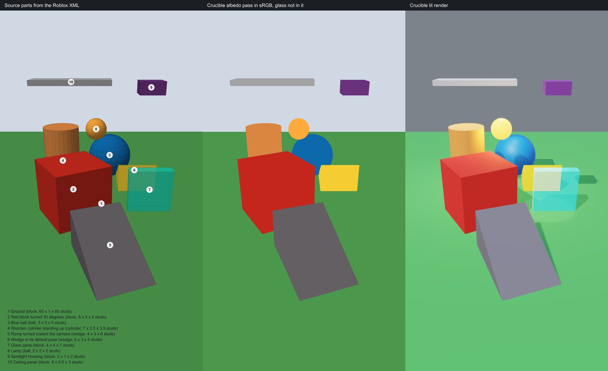

# Roblox-style scene import



Left: the parts of a small hand-written place, drawn flat from the raw numbers of the XML file. Middle: the albedo pass of the imported scene, which is the colour of each part before any light. Right: the same file imported and rendered lit by Crucible. Size, position, turn, colour, transparency, the three lights and the camera carry over. The grey sky and the soft light on the right are the default look of Crucible, which the file does not set, so the lit colours differ from the flat ones; the middle picture shows the colours themselves match. The blended glass pane is not in the albedo pass.

Colour check: the mean albedo of every part, read from the pass and converted to sRGB, differs from the part's source `Color3` by CIEDE2000 0.03 to 0.34, worst the ramp (0.34), against a bound of 5. `node scripts/render-roblox-import.mjs tests/fixtures/roblox-sample.rbxlx <folder>` prints the table.

`@codepawlhq/crucible-roblox-import` (folder `packages/roblox-import`) turns Roblox-style scenes exported from Roblox Studio, the XML place files (`.rbxlx`) and model files (`.rbxmx`), into a Crucible scene recipe. It is a companion package, not part of the core archive: it imports no dependency and no Crucible module, reads no network, and registers nothing, so the MCP server does not load it with `--allow-addon`.

```js
import { importRoblox } from '@codepawlhq/crucible-roblox-import';
import { importRobloxFile } from '@codepawlhq/crucible-roblox-import/node';

const { recipe, warnings } = importRoblox(xmlText);                                // text in, recipe out
const result = await importRobloxFile('place.rbxlx', { assetFolder: './assets' }); // file and local assets
await loadAgentSceneModules(recipe);                                               // the wedge is an extrusion
const scene = createAgentScene(recipe);                                            // or pass the recipe to scene_create
```

The binary `.rbxl` and `.rbxm` files are not read. In Roblox Studio use File, Save As and pick the XML type.

## What is read

| Roblox | Crucible |
| --- | --- |
| `Part` with Shape Block, Ball or Cylinder | a box, sphere or cylinder node. A cylinder runs along its local X and its Y and Z are the diameter, as in Roblox |
| `WedgePart` | a right triangle prism: its tall flat side is local +Z, its floor is -Y and the slope rises toward the back |
| `SpawnLocation`, `Seat`, `VehicleSeat` | drawn as the Part shape they carry |
| `MeshPart` | a GLB from the asset folder, fitted to the part `Size` and centred on the part (see below) |
| `Size`, `CFrame` | scale and translation in metres, rotation as a quaternion |
| `Color3uint8` or `Color`, `Material`, `Transparency`, `Reflectance` | linear colour, roughness, metallic, emission (Neon, ForceField, CrackedLava), `opacity` with `alphaMode: blend` |
| `PointLight` | `environment.pointLights` at the part, with `range` |
| `SpotLight` | `environment.spotLights` on the chosen `Face`, `Angle` as the full cone (Crucible takes the half angle) |
| `SurfaceLight` | `environment.areaLights`, a rectangle the size of the chosen `Face` |
| `Camera` | `camera` with eye, target, up and the vertical `fov`. `Workspace.CurrentCamera` wins, else the first camera |
| `Model`, `Folder`, `Tool` and similar | walked, their parts are read |

Units and axes: 1 stud is 0.28 m. Roblox and Crucible are both right-handed with Y up and a camera that looks down its local -Z, so no axis is flipped. A `CFrame` must be a pure rotation: a mirrored or scaled matrix stops the import and names the part. The field of view is vertical in both; a camera with another `FieldOfViewMode` is listed in `warnings`. Colours are sRGB in Roblox and are converted to the linear values a recipe holds.

Known limit: which way the wedge leans is not settled by Roblox's public documentation. The [WedgePart page](https://create.roblox.com/docs/reference/engine/classes/WedgePart) says only that it is "great for building slopes because of their slanted surface" and can be rotated onto its slant; it does not say which face is tall. The importer puts the tall flat side at local +Z with the slope rising toward the back, and a test pins that, so a correction after a check in Roblox Studio is one line.

Light strength has no unit in the Roblox documentation (its own [point light example](https://create.roblox.com/docs/reference/engine/classes/PointLight) uses Brightness 1 and Range 16 studs). A `Brightness` of 1 becomes 4 candela (`CANDELA_PER_BRIGHTNESS`). This is an approximation: Roblox `Brightness` has no physical unit, so 4 was chosen by measurement, not derived. `node scripts/measure-roblox-light.mjs` renders a top-down grey card under Crucible's default sun and ambient light, with and without a Brightness 1, Range 8 point light one metre above it. Directly below the lamp the card's linear luma rises 1.63 times (pixel luma 174.5 to 217.1), 1.43 times at 0.5 m, 1.18 times at 1 m and 1.04 times at 1.5 m, and nothing past the 2.24 m range. A white card peaks at 250, not clipped. So the lamp is visible but does not take over a sunlit scene. An earlier value of 12 candela over-drove the lights and blew a white part out to 255. `Range` converts from studs, and Spot and Surface lights default to 16 studs like Roblox. Tune the exported recipe if a scene needs another balance. Crucible draws at most 16 point, 8 spot and 7 area lights, so extra lights are dropped in document order with a warning.

Materials map to the plain fields every recipe has (colour, roughness, metallic, emission). Material presets with patterns (wood, brick, grass) wait for #3234.

## Meshes and textures: a local folder

A `MeshPart` names its mesh by asset id. The importer never fetches anything: put the files in a folder and an `asset-map.json` beside them.

```json
{ "rbxassetid://123456": "tree.glb", "http://www.roblox.com/asset/?id=789": "bark.png" }
```

A key may be `rbxassetid://N`, an asset URL with `?id=N` (only the number is used, the URL is not opened) or the bare number. Files must sit inside the folder (a path that leaves it is refused), be `.glb`, `.png`, `.jpg`, `.jpeg` or `.webp`, and be at most 64 MiB, with at most 4096 entries. `importRobloxFile` hashes each file: the mesh node carries `asset.id` as the SHA-256 of the GLB, which is the id `scene_asset_catalog` gives the same file, so start the MCP server with `--assets <folder>` and the recipe places it. The mesh is scaled so the bounding box of the GLB (read from its accessor min and max, node transforms applied) equals the part `Size`, and its centre is put on the part centre. `result.assets` lists every mapped file the scene uses.

An unmapped mesh stops the import and names the asset id and the line to add. A `TextureID` is looked up the same way and listed in `assets`, but it is not drawn yet: the GLB keeps its own materials. `Decal`, `Texture`, `SurfaceAppearance`, `SpecialMesh`, particle emitters and GUI objects are skipped with one warning per class.

## Errors and limits

Every error says what failed and what to pass. A class that this importer cannot read (`UnionOperation`, `TrussPart`, `CornerWedgePart`, `Terrain` and anything unknown) stops the import with its class, its name and a way out; pass `skipUnsupported: true` to leave such objects out and get a warning instead. Scripts, joints, values and similar classes carry no geometry and are listed in `ignored`. Services outside the world (`Lighting`, `StarterGui`, `ReplicatedStorage` and others) are skipped whole.

| Option | Default | At most |
| --- | --- | --- |
| `maxBytes` (XML text, counted in UTF-8 bytes) | 64 MiB | 256 MiB |
| `maxParts` | 20,000 | 100,000 |
| `maxItems` (XML elements) | 200,000 | 1,000,000 |
| `maxDepth` (nesting) | 128 | 512 |

Unknown options throw. The import is deterministic: the same text gives the same recipe byte for byte, node ids are `<name>-<index>` in document order, and numbers are rounded to seven decimals.

## Reproduce the picture

```sh
node scripts/render-roblox-import.mjs tests/fixtures/roblox-sample.rbxlx artifacts/roblox
```

It imports the sample, renders 1080x1920 through the MCP render job, draws the diagram from the raw XML numbers with its own small reader, and writes the side-by-side image and a JSON with the recipe, camera and size. `tests/roblox-import.test.js` checks the unit and axis conversion (including CFrame rotation against a direct matrix product), the wedge orientation, lights, the camera, the errors and limits, determinism, and that no network call is made.
